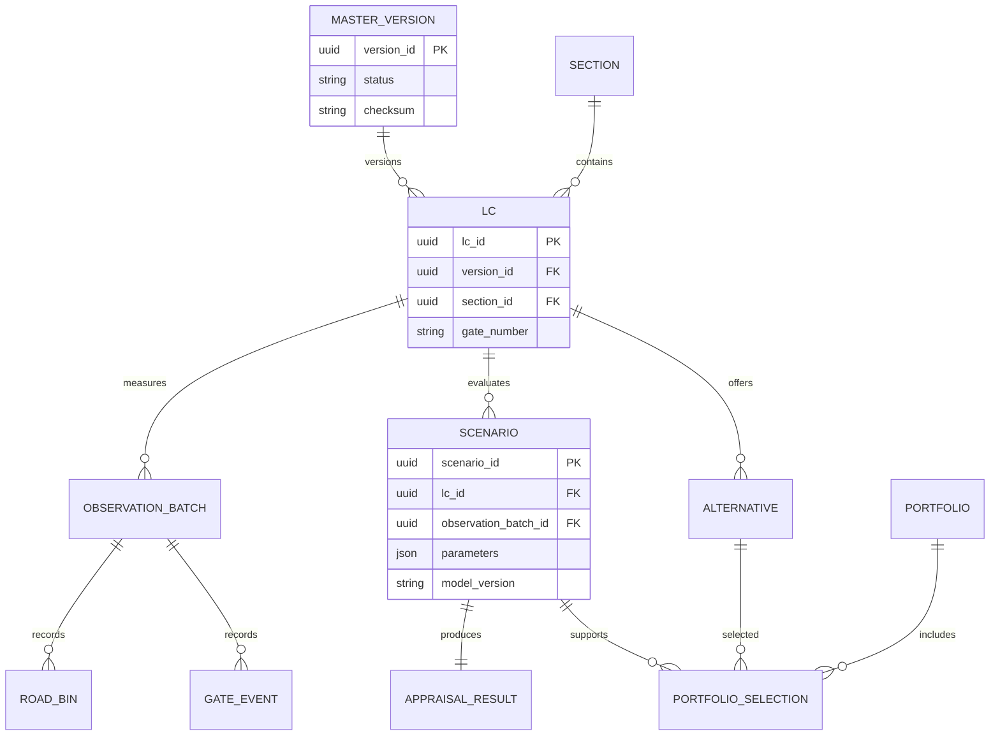

# Entity relationship diagram
Author: R. Gopalakrishnan | Production target; current runtime uses JSON and stateless services.

Relationships across service boundaries are logical references and must not require distributed foreign-key writes. LC versions use composite (lc_id,version_id) keys. A scenario fixes its LC/master version and input snapshot. Retain is implicit in current optimizer; production stores an explicit retain alternative with zero incremental benefit and cost.
