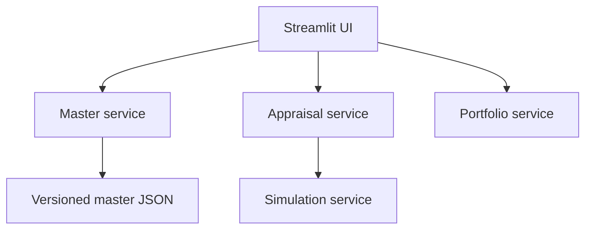

# Microservice architecture
Author: R. Gopalakrishnan | Version 1.0

## Deployable boundaries
| Service | Port | Owned contract | Current store |
|---|---|---|---|
| Master | 8001 | GET /v1/master/lcs; GET /v1/master/treatments | Read-only external JSON |
| Simulation | 8002 | POST /v1/simulate (Scenario) | Stateless |
| Appraisal | 8003 | POST /v1/appraise (Scenario) | Stateless; HTTP simulation dependency |
| Portfolio | 8004 | POST /v1/optimize (Portfolio) | Stateless MILP |
| UI | 8501 | Browser interaction | Session-state results |

Each service has /health and generated /docs and /openapi.json. Shared core is a versioned calculation library; it does not create a shared writable database. Monorepo packaging is an initial delivery choice, not a requirement to deploy services together. Local mode runs the core directly for convenient Streamlit hosting; remote mode uses HTTP service boundaries.

## Request and reproducibility
UI reads treatment defaults, creates a Scenario snapshot, submits appraisal, receives simulation plus appraisal, exports full input/model version. Portfolio accepts pre-appraised treatment rows, validates feasibility and mutually exclusive treatments, returns status, selection, objective and solver gap. Invalid Pydantic input produces 422; upstream simulation failure produces 503. No silent local fallback in remote mode.

## Production evolution
Separate master PostgreSQL, observation time-series/object store, scenario/result store and portfolio store. Use service-owned schemas and outbox events (MasterVersionPublished, ObservationBatchValidated, ScenarioCompleted, PortfolioReviewed). Add a job queue for large simulation batches, idempotency keys, request IDs, schema migration tooling, SSO gateway, monitoring and audited approvals. Raw observations must remain immutable; a corrected batch supersedes an older batch. Pin container dependencies and scan images before production release.

## Rail benefit overlap
Direct delay and extra-path value may describe the same economic mechanism. Analysts must justify separation. MVP applies at most one capacity-claiming selected candidate per section as a conservative safeguard; production must calculate shared corridor packages and marginal portfolio capacity through a network model. This restriction may exclude valid combinations and does not prove economic independence.
